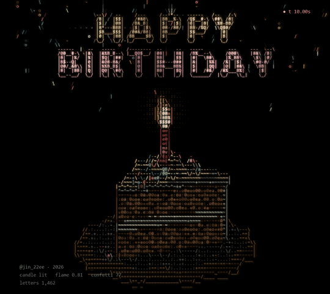
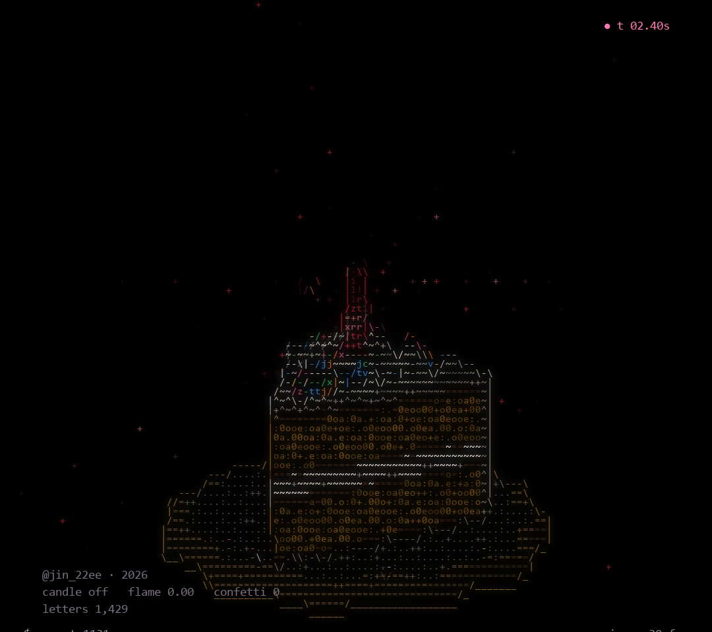
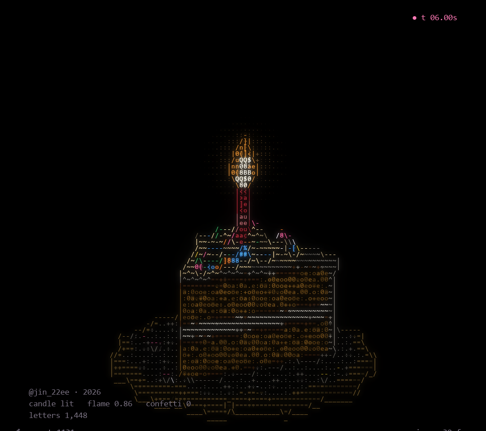
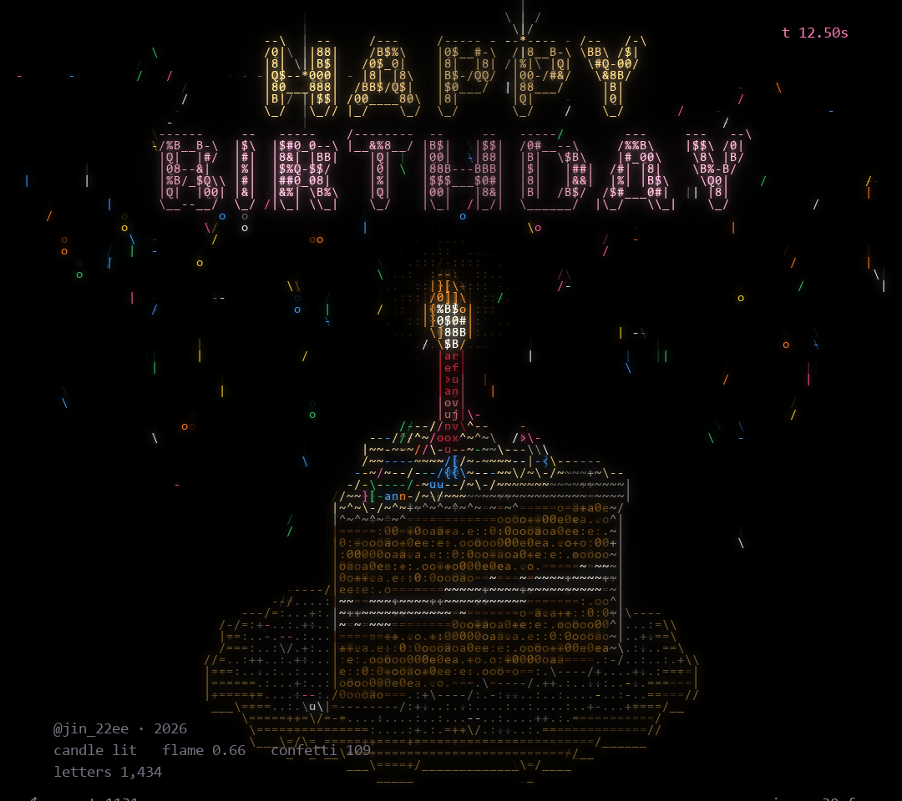

# HAPPY BIRTHDAY

Birthday Cake · ASCII Code Art by JIN2, 2026



## Artist's Note

A slice of birthday cake builds itself from the plate up, a single candle is lit, and its warm light flickers across the frosting.
Confetti falls, and the wish appears above, drawn only with letters, numbers and symbols.

| building | candle | happy birthday |
|---|---|---|
|  |  |  |

## Technology

Python · NumPy · pygame-ce · Pillow

## Creative Process

1. Form: the slice, its sponge and cream layers, frosting, candle, sprinkles and plate are built in 3D.
2. Build: the cake appears from the plate upward, with a few letters flying in.
3. Candlelight: the flame is lit, and a warm light reaches only the part of the cake close to it.
4. Celebration: confetti falls and the two words pop in above the cake.
5. ASCII Rendering: the scene becomes a grid of characters, each material with its own letters.

## Technical Concepts

3D geometry and rotation · perspective projection with depth ordering · surface normals
Diffuse and specular lighting · local point light with falloff · outline detection · text rasterised into a character grid

## Source Code

The full Python source is free and included in this folder.

```
pip install -r requirements.txt
python birthday_cake.py
```

Space pause, R restart, S screenshot, Esc quit.
Free for personal projects. Please credit @jin_22ee if you share what you make. See LICENSE.txt.

---

Artist: JIN2 · Instagram [@jin_22ee](https://instagram.com/jin_22ee)
© 2026 JIN2. All rights reserved. Images and video in this repository may not be reused without permission.
