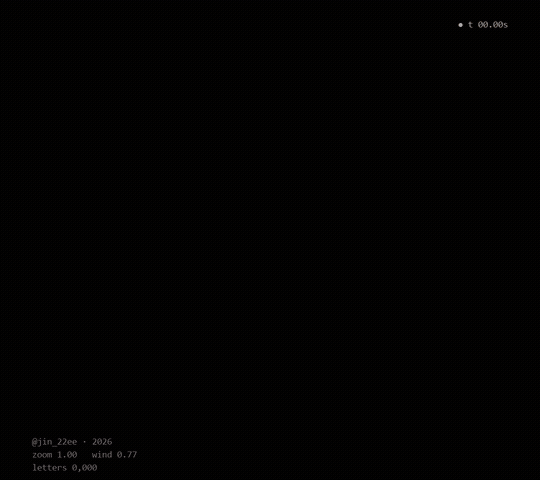
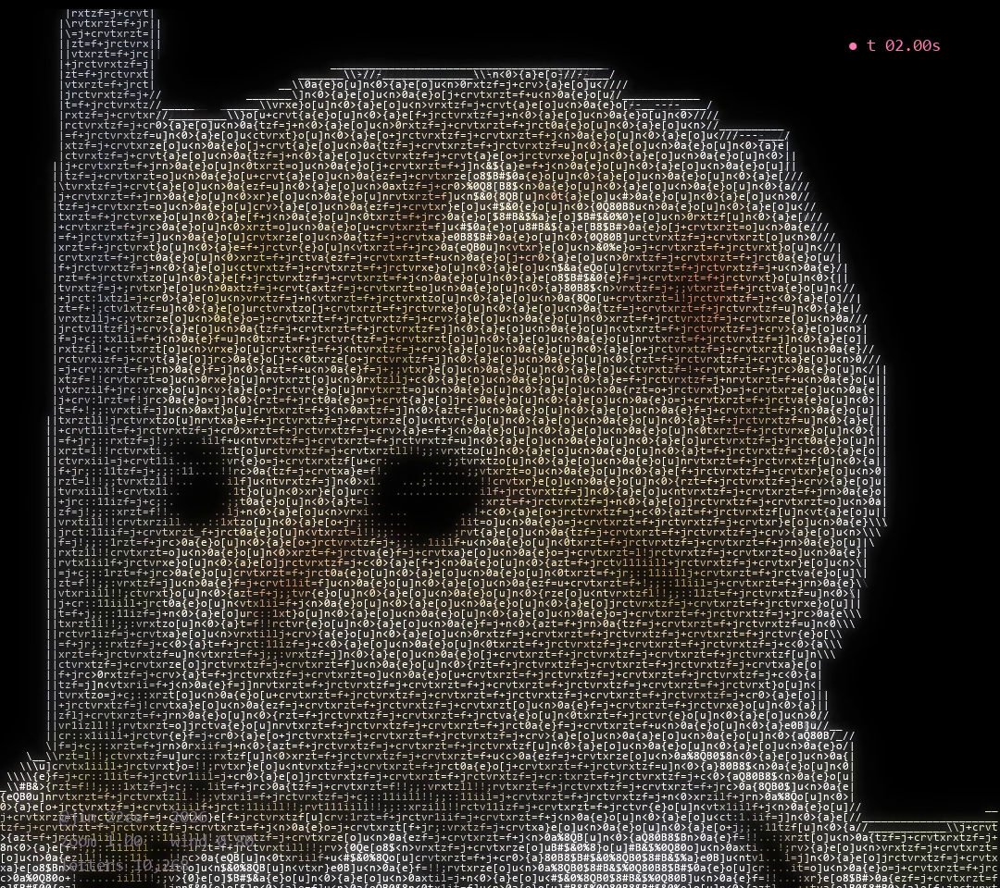
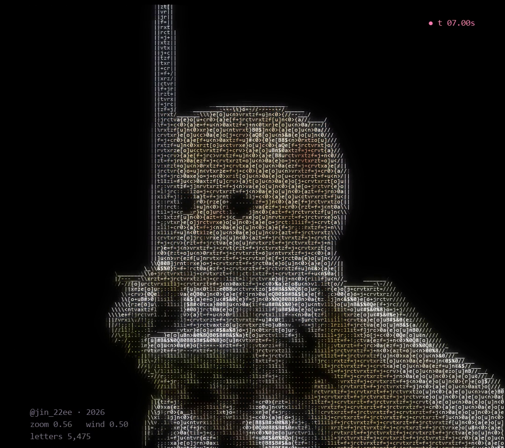
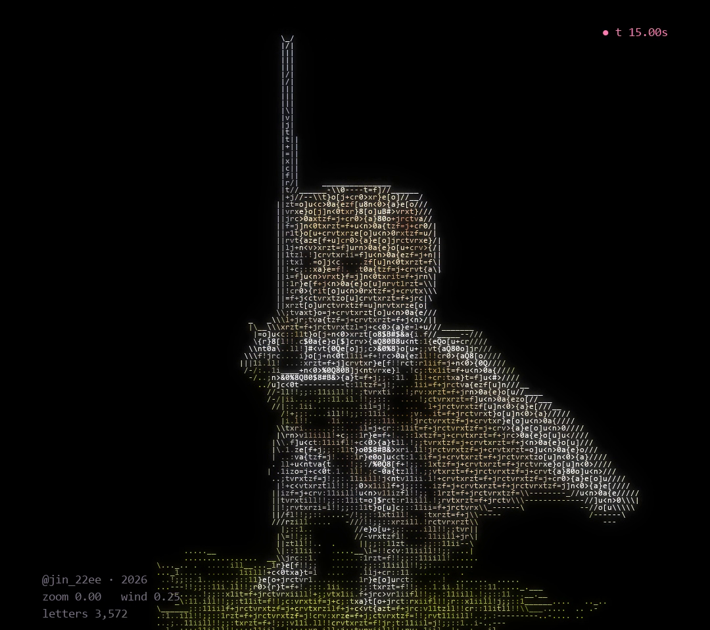

# CAT KNIGHT

Cat Knight · ASCII Code Art by JIN2, 2026



## Artist's Note

A tiny kitten in full armour, holding a sword bigger than itself.
The camera starts on its face and slowly pulls back to the whole knight, while the wind moves the cape, the fur and the grass.
Every letter takes its colour and weight from a photo.

| face | pulling back | the knight |
|---|---|---|
|  |  |  |

## About the Photo

The kitten knight photo is not mine, so this piece is not for sale and the photo is not included.
The finished letters of all 600 frames are in cat_knight_frames.npz, and the full code to play them is shared here.
All credit for the photo goes to its creator.

## Technology

Python · NumPy · pygame-ce (the frames were made with OpenCV)

## Creative Process

1. Cut out: the knight is cut out of the photo and split into three layers (knight, cape, grass).
2. Cloth: a 9 x 9 grid of points with springs is laid over the cape, pinned at the shoulder, and pushed by gusts of wind.
3. Wind: the fur on the edge of the head and the grass shift with the same wind.
4. Camera: the view starts on the face and pulls back to the whole knight.
5. ASCII Rendering: each frame becomes a grid of letters; brightness picks the letter, edges become | / \ - _ and the colour comes from the photo.

## Technical Concepts

Image cutout with an alpha mask · mass spring cloth with Verlet steps · image warping with remap
Camera zoom on a letter grid · edge detection with Sobel · colour palette by k-means

## Source Code

The full Python source is included in this folder.

```
pip install -r requirements.txt
python cat_knight.py
```

Space pause, R restart, S screenshot, Esc quit.
For personal projects. Please credit @jin_22ee if you share what you make. See LICENSE.txt.

---

Artist: JIN2 · Instagram [@jin_22ee](https://instagram.com/jin_22ee)
Code © 2026 JIN2. The kitten knight photo belongs to its creator.
