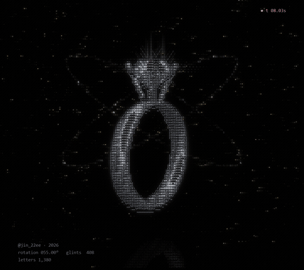
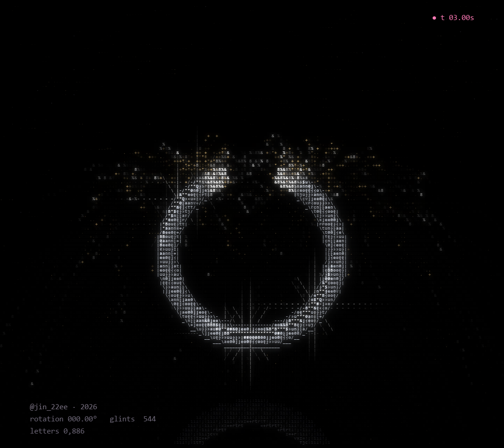
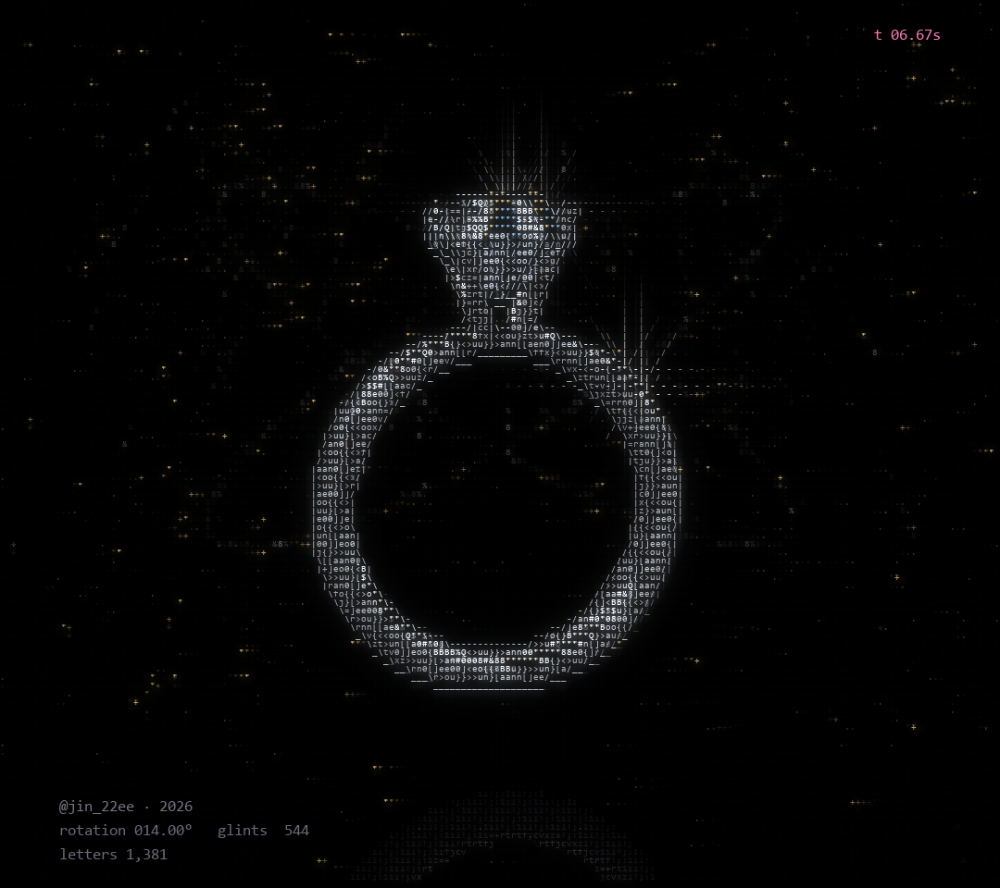
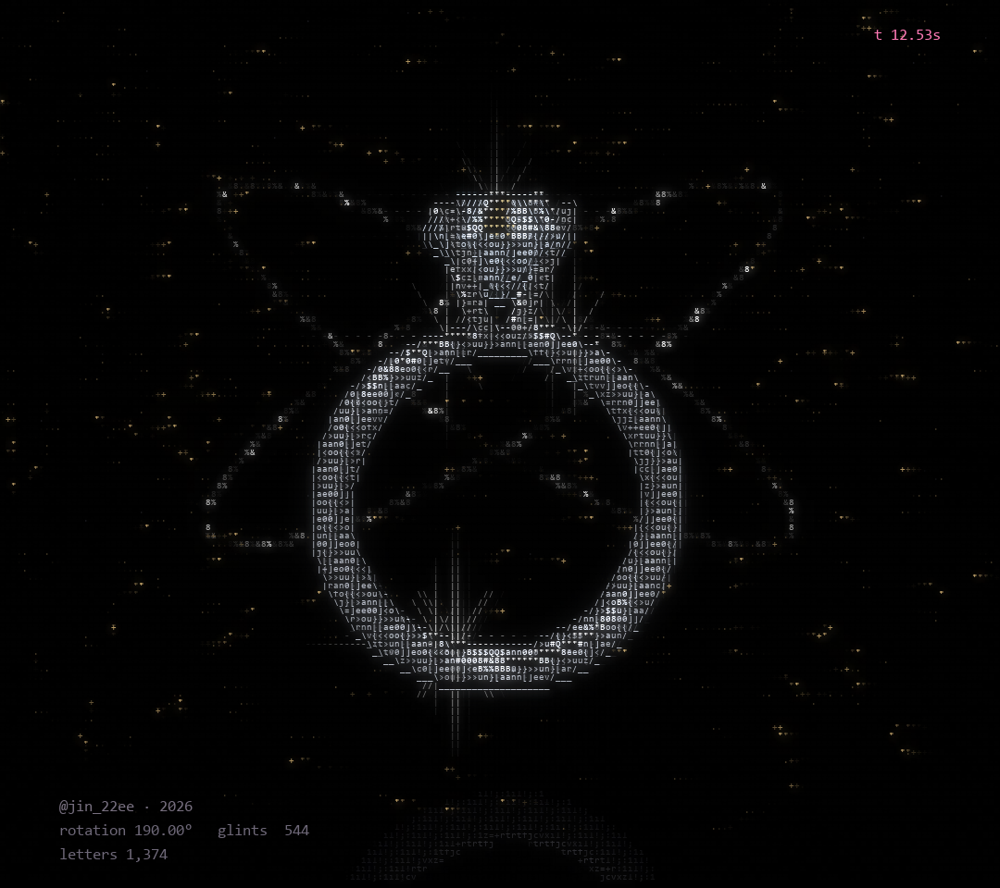

# WILL YOU

Diamond Ring · ASCII Code Art by JIN2, 2026



## Artist's Note

A diamond ring emerges from light, gradually taking shape through characters and motion.
A small object that carries a very large question, drawn only with letters, numbers and symbols.

| forming | finished | turning |
|---|---|---|
|  |  |  |

## Technology

Python · NumPy · pygame-ce

## Creative Process

1. Form: the band, prongs and a faceted diamond are built in 3D.
2. Motion: the ring is drawn in by a travelling point of light, then turns slowly.
3. Lighting: a fixed light and a moving light make the metal shine and the facets sparkle.
4. Particles: golden sparks, a ring of light, orbits and dust move around it.
5. ASCII Rendering: the scene becomes a grid of characters, shaded by brightness.

## Technical Concepts

3D geometry and rotation · perspective projection with depth ordering · diffuse and specular lighting
Particle animation with gravity · outline detection · character-based shading

## Source Code

The full Python source is free and included in this folder.

```npip install -r requirements.txt
python diamond_ring.py
```n
Space pause, R restart, S screenshot, Esc quit.
Free for personal projects. Please credit @jin_22ee if you share what you make. See LICENSE.txt.

If you'd like to support my work, the same code is also on [Payhip](https://payhip.com/b/4vXRc).

---

Artist: JIN2 · Instagram [@jin_22ee](https://instagram.com/jin_22ee)
© 2026 JIN2. All rights reserved. Images and video in this repository may not be reused without permission.
