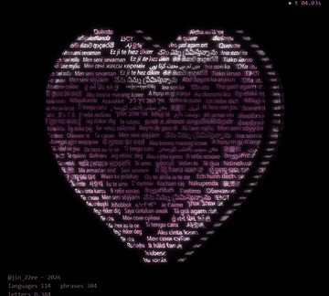
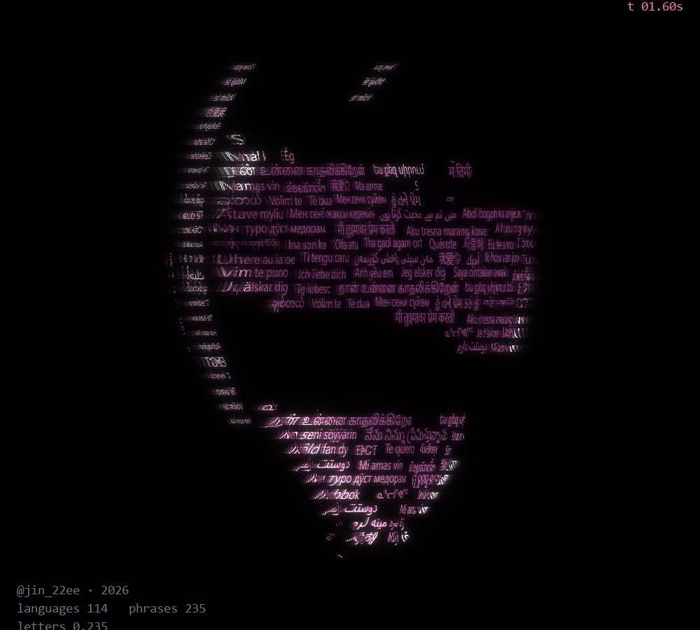
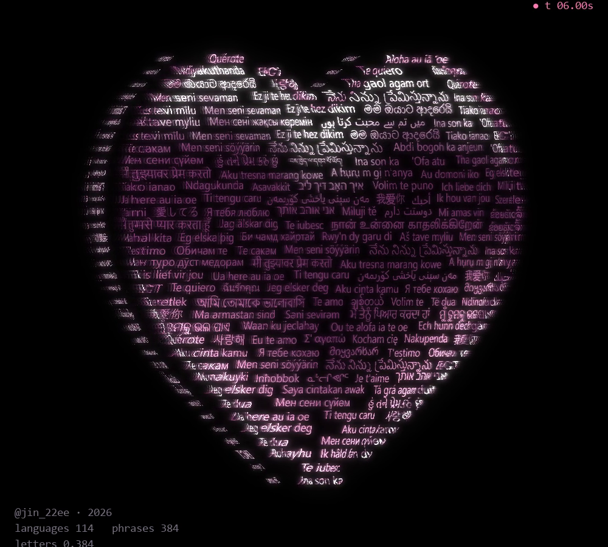
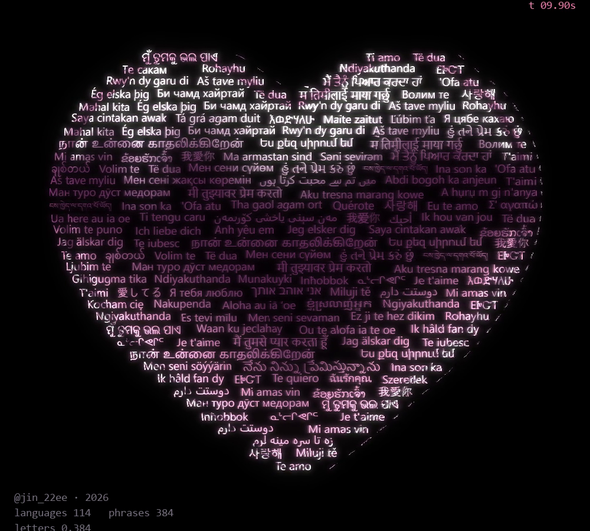

# I LOVE YOU

Heart · ASCII Code Art · JIN2, 2026



## Artist's Note

Someone asked me to make a heart that says "I love you" to everyone, in every language.
I had seen something like it before and had wanted to make one myself.
"I love you" in 114 languages, written row by row, and the letters alone make the heart.

| typing | turning | front |
|---|---|---|
|  |  |  |

## Technology

Python · NumPy · OpenCV · pygame-ce

## Creative Process

1. Phrases: "I love you" in 114 languages, each drawn once so every script is shaped correctly.
2. Outline: half a heart as a list of points, mirrored into the whole shape.
3. Rows: each row of the heart is filled edge to edge with whole phrases, like justified text.
4. Depth: flat sides, bulging faces and a raised rim give the heart its thickness.
5. Turning and light: the heart turns to the right while a chrome reflection slides across the letters.

## Technical Concepts

Justified text layout · distance transform for depth · rotation about the vertical axis with depth ordering
Environment-style chrome reflection · trail and glow pass

## Source Code

The full Python source is free and included in this folder.

```
pip install -r requirements.txt
python i_love_you.py
```

Space pause, R restart, S screenshot, Esc quit.
Free for personal projects. Please credit @jin_22ee if you share what you make. See LICENSE.txt.

If you'd like to support my work, the same code is also on [Payhip](https://payhip.com/b/SOw4m).

---

Artist: JIN2 · Instagram [@jin_22ee](https://instagram.com/jin_22ee)
© 2026 JIN2. All rights reserved. Images and video in this repository may not be reused without permission.
