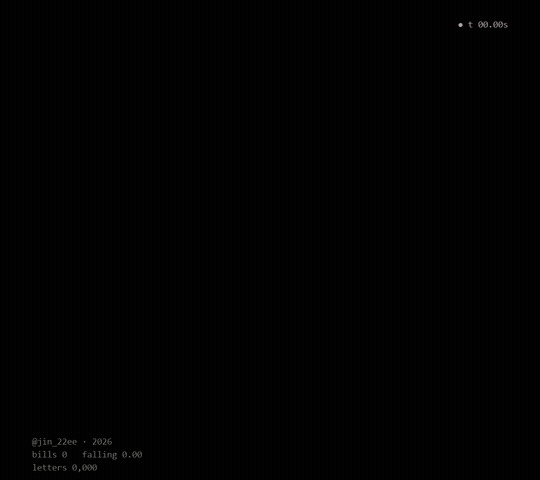
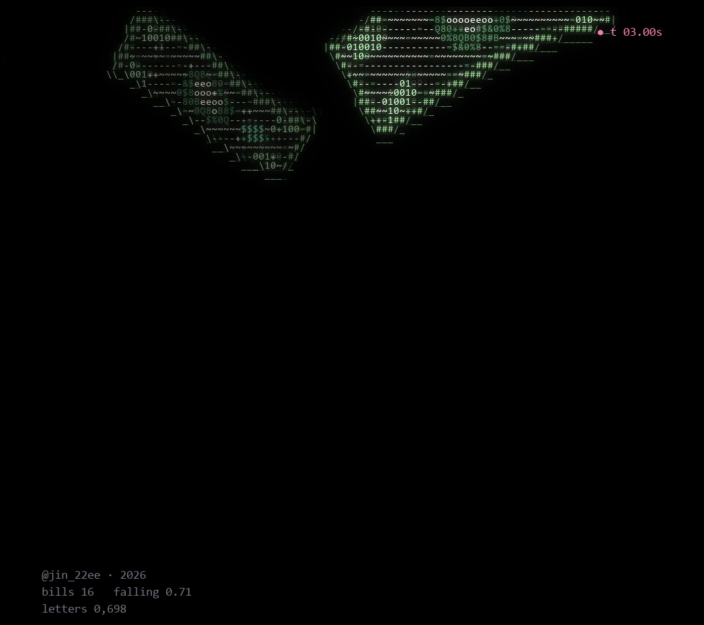
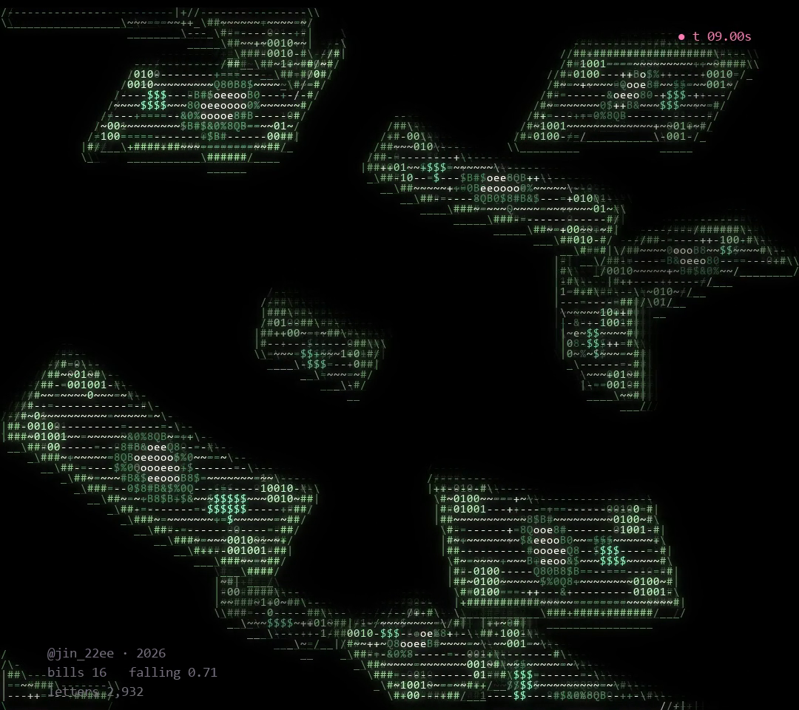
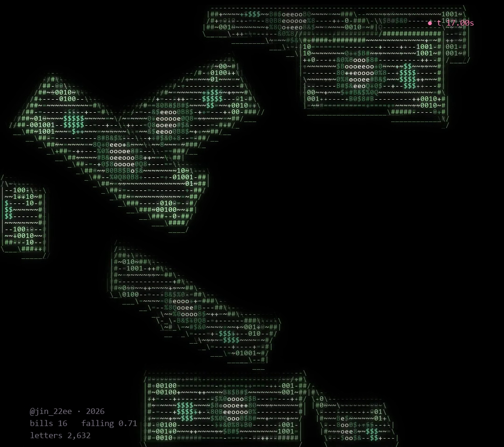

# MONEY RAIN

Money Rain · ASCII Code Art by JIN2, 2026



## Artist's Note

Hundred-dollar notes fall one after another, each at its own depth and speed.
They sway, tumble and turn on the way down, and every note is drawn only with letters, numbers and symbols.

| first notes | rain | full rain |
|---|---|---|
|  |  |  |

## Technology

Python · NumPy · pygame-ce

## Creative Process

1. Form: one hundred-dollar note is a grid of points, and each point knows what is printed on it (border, frame lines, portrait, seal, the 100 in each corner).
2. Falling: sixteen notes start one after another, each with its own place, depth, speed and wobble.
3. Motion: a note sways from side to side, tumbles and turns, and a soft S-curve rolls along the paper.
4. ASCII Rendering: the screen becomes a grid of letter cells. Edges turn into | / \ - _ and the inside gets letters for what is printed there.
5. Depth: notes further away are drawn dimmer.

## Technical Concepts

3D rotation and perspective projection · nearest point per cell with depth ordering · outline detection
Per-note motion (sway, tumble, paper curl) · character pools from dark to bright · glow pass

## Source Code

The full Python source is free and included in this folder.

```
pip install -r requirements.txt
python money_rain.py
```

Space pause, R restart, S screenshot, Esc quit.
Free for personal projects. Please credit @jin_22ee if you share what you make. See LICENSE.txt.

---

Artist: JIN2 · Instagram [@jin_22ee](https://instagram.com/jin_22ee)
© 2026 JIN2. All rights reserved. Images and video in this repository may not be reused without permission.
