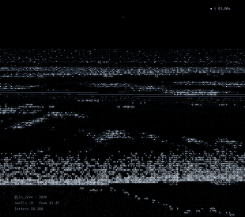
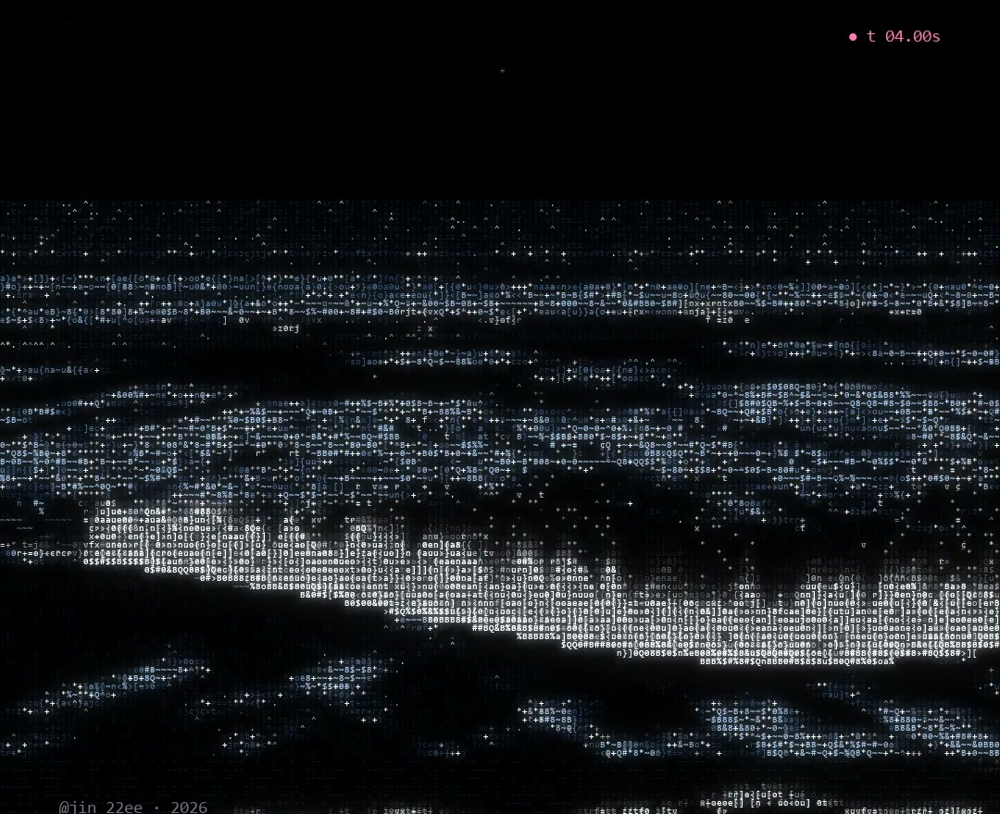
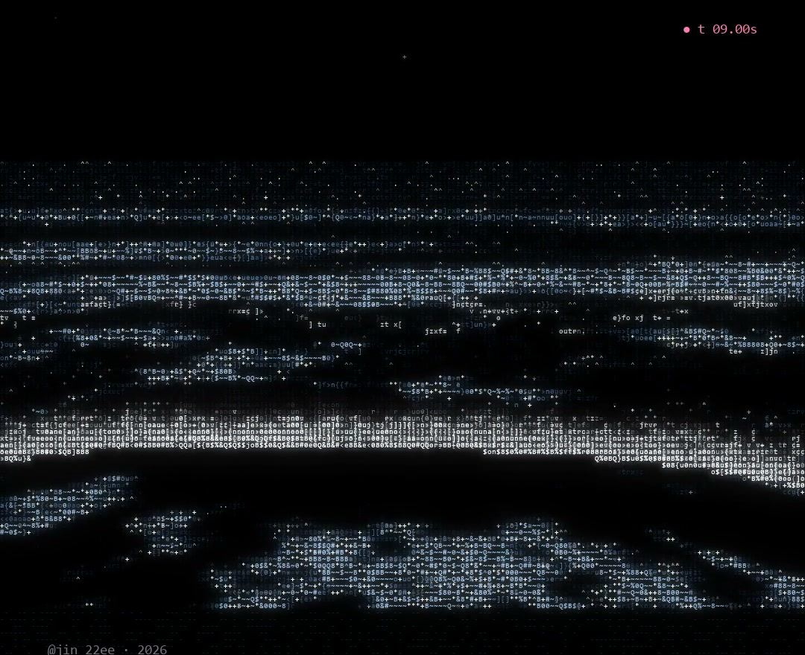
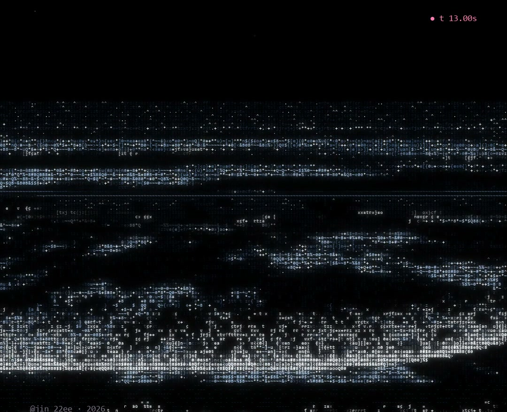

# NIGHT TIDE

The sea at night · ASCII Code Art · JIN2, 2026



## Artist's Note

Dark water at night, with only a little light moving on it.
Waves roll in one after another, each with its own angle, size and strength, break into white foam and run up the sand.
There is no moon in the sky. You only see it as glitter on the water.

| rolling in | breaking | glitter |
|---|---|---|
|  |  |  |

## Technology

Python · NumPy · pygame-ce

## Creative Process

1. Camera: a view from the beach, each cell of the screen mapped to a point on the water.
2. Sea: many swells of different sizes and directions are layered into one moving surface.
3. Light: each tilted bit of water mirrors the night sky, and lit crests flash like moonlight.
4. Breakers: every wave rises, breaks into white foam, rushes in and slides back over the sand.
5. ASCII Rendering: the light on the water becomes letters, from faint to dense, in shades of blue.

## Technical Concepts

Gerstner waves · perspective projection · Fresnel reflection · procedural foam and spray
Level-of-detail filtering · character-based shading

## Source Code

The full Python source is free and included in this folder.

```
pip install -r requirements.txt
python night_tide.py
```

Space pause, R restart, S screenshot, Esc quit.
Free for personal projects. Please credit @jin_22ee if you share what you make. See LICENSE.txt.

If you'd like to support my work, the same code is also on [Payhip](https://payhip.com/b/TrI0Y).

---

Artist: JIN2 · Instagram [@jin_22ee](https://instagram.com/jin_22ee)
© 2026 JIN2. All rights reserved. Images and video in this repository may not be reused without permission.
