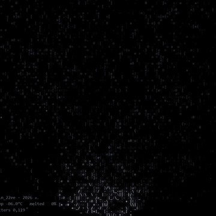
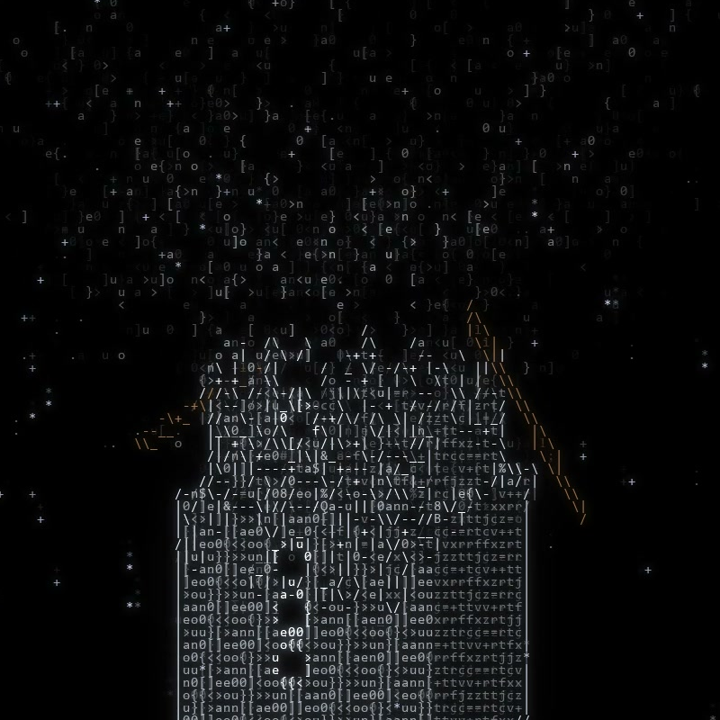
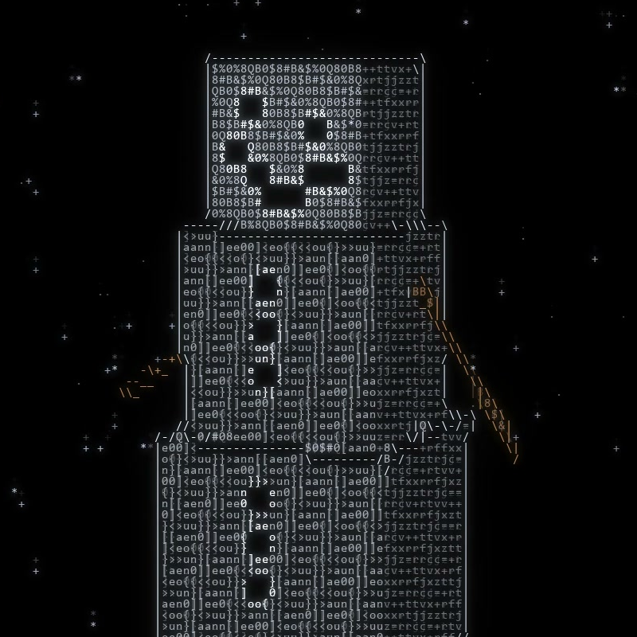
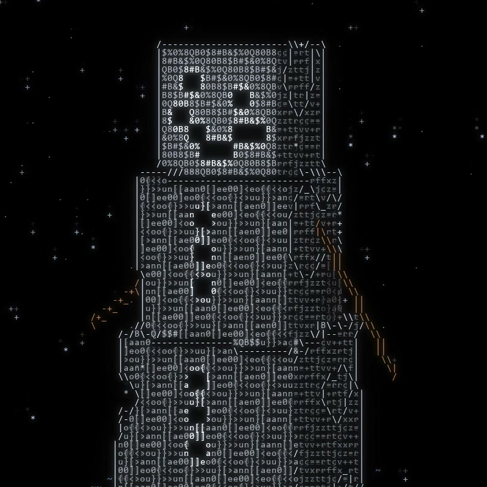

# DON'T MELT

Snowman · ASCII Code Art · JIN2, 2026



## Artist's Note

It's winter, and listening to the song Snowman made me think of Wilson, my name for the Minecraft snowman.
Then I wondered: what if Wilson melted?
A little block snowman made of letters stands in the falling snow and melts piece by piece, smiling until the very end.

| gathering | standing | melting |
|---|---|---|
|  |  |  |

## Technology

Python · NumPy · pygame-ce

## Creative Process

1. Form: three blocks of voxels stacked from large to small, with eyes, smile and buttons left out as black squares.
2. Build-in: the letters gather from the bottom up, a few flying in from the dark.
3. Snow: hundreds of flakes drift down around him, nearer ones brighter.
4. Melting: chunks come loose one by one, fall with gravity, bounce twice, skid and melt into a puddle.
5. ASCII Rendering: points become letters, denser where the surface is brighter, with outlines along the edges.

## Technical Concepts

Voxel point clouds · fixed perspective camera with depth ordering · projectile motion with bounces and friction
Outline detection · character-based shading · trail and glow pass

## Source Code

The full Python source is free and included in this folder.

```
pip install -r requirements.txt
python snowman.py
```

Space pause, R restart, S screenshot, Esc quit.
Free for personal projects. Please credit @jin_22ee if you share what you make. See LICENSE.txt.

---

Artist: JIN2 · Instagram [@jin_22ee](https://instagram.com/jin_22ee)
© 2026 JIN2. All rights reserved. Images and video in this repository may not be reused without permission.
